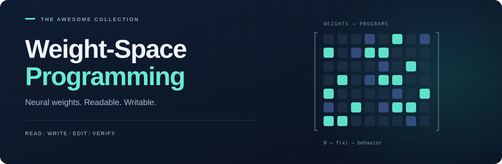

  <picture>
    <source media="(max-width: 640px)" srcset="assets/hero-mobile.svg">
    
  </picture>

# Awesome Weight-Space Programming 中文导读

[English / 完整资源目录](README.md) · [贡献指南](CONTRIBUTING.md)

面向 Weight-Space Programming 的独立开源资源清单：集中发现关键论文、可运行项目与评测基准，从理解概念到动手探索。

⭐ 如果这份清单对你有帮助，欢迎 **Star 收藏**，也欢迎分享给同样关注这个方向的人。

最后整理日期：2026-11-03。

## 从哪里开始

1. [Sparks of Weight-Space Programming](https://rikiyat.github.io/blog/weight-space-programming/)：从权重识别行为、修复网络、直接构造策略网络的起点；[实验日志](https://github.com/RikiyaT/lm_understand-logs)。
2. [Weight-Space Programming from scratch on simple tasks](https://csinva.io/weight-space-programming-autoresearch/analyze/toy_examples/report.html)：用简单算法任务理解“把算法写进权重”；[代码与快照](https://github.com/csinva/weight-space-programming-autoresearch)。
3. [Tracr](https://github.com/google-deepmind/tracr)：把形式化程序编译成 Transformer，用于比较 LLM 自由构造与确定性编译。

前两项是博客与公开实验项目，不能直接当作已同行评审论文。英文主目录提供完整分类、作者、发表情况和代码链接。

## 分类地图

| 类别 | 核心问题 | 入口 |
| --- | --- | --- |
| 直接权重编程 | LLM 能否理解张量并写出或修复网络？ | [原始工作](README.md#direct-weight-space-programming) |
| 社区实验与基准 | 不同模型、访问条件与复现方式下是否成立？ | [五个社区项目](README.md#community-experiments-and-benchmarks) |
| 程序到权重 | 如何把可读算法变成神经网络？ | [RASP、Tracr、Transformer Programs](README.md#programs-to-transformer-weights) |
| 学习式权重生成 | 训练一个网络来预测另一个网络的参数 | [HyperNetworks、参数预测](README.md#learned-weight-generation) |
| 权重空间建模 | 如何处理神经元置换与权重表示？ | [NFN、NFT、Deep-Align](README.md#networks-that-process-weights) |
| 模型编辑 | 如何通过权重更新改变已有行为？ | [ROME、Task Arithmetic](README.md#related-model-editing) |
| 机制基础 | 注意力与残差通道在计算什么？ | [Transformer Circuits](README.md#mechanistic-foundations) |

## 阅读时需要分清

- **目标网络没有训练，不等于整个系统没有学习与搜索。** 写权重的 LLM 已经预训练，部分实验还使用评测反馈。
- **算法任务样例满分，不等于全域正确或长度外推。** 查表和可推广算法也应分别评估。
- **“没有梯度”不等于没有拟合。** 简单任务项目已公开承认部分语言实验的数据泄漏与拟合问题。
- **“零参数”不等于零存储。** 常量可能转移到 buffer 或代码中。
- **重评已有输出、评测公开 checkpoint、重新执行编辑搜索，是不同层次的复现。** 社区条目按各自范围描述，不把项目自述视为本仓库的独立验证。

## 一起完善这份清单

- **推荐资源：**通过 [Issue](https://github.com/brighterr/awesome-weight-space-programming/issues/new/choose) 提交值得关注的论文、项目或复现。
- **补充与纠错：**按照 [贡献指南](CONTRIBUTING.md) 发起 PR，帮助更新链接、分类和实验说明。
- **收藏与分享：**Star 仓库，或把清单分享给研究者、开发者和学习伙伴。

完整资源条目维护在英文主目录，中文导读提供阅读路线与背景说明。
